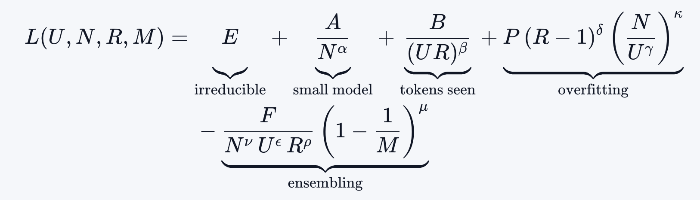

# Quadrillion-parameter transformers and how to train them

**Date:** 3rd November 2026

[Blog Post](https://qlabs.sh/research/parameters)

## Key Points
* Humans are 1,000,000x more sample efficient than current AI models
    * Chinchilla paper prescribed we need at least 20:1 token to weight ratio
    * Human brain has ~100T parameters (synapses) and learn from ~200M tokens... the ratio 1:500,000. (My thought: this doesn't include evolution as training)
    * Token ratio is 10,000,000x lower in humans
    * If humans had 5T tokens... they could train a quintillion parameter model
* Find that with their ensemble and multiple epoch method, they can get up to 300 parameter per token at 1e29 training FLOPs and that this keeps growing with compute.
* Why multi-epoch?
    * Compute is growing faster than the amount of high quality training data
    * Will therefore have to switch to a multi-epoch on same data

## Results
* Find taht they can fit a model of the loss to:
    1. Number of unique tokens in the dataset, U
    2. Model size, N
    3. Number of epochs, R
    4. Number of ensemble members, M

* **Contains regularisation**: larger models obvioously need more regularisation to prevent overfitting
    * **Find optimal weight decay scales rapidly with numbeer of epochs and model size**

## Key Methods
* Find compute optimal model size on fixed dataset with different number of FLOPs
* Aslo test multi-epoch training and ensemble of model training
* Snapshot ensembles:
    * Take checkpoints from throughout training and average their output.
    * Lowers loss at no extra compute cost
    * To ensure models are diverse: train with cyclic learning rate and save snapshot at lowest point in sample
    * They also Deep Ensembles which means multiple training runs.
